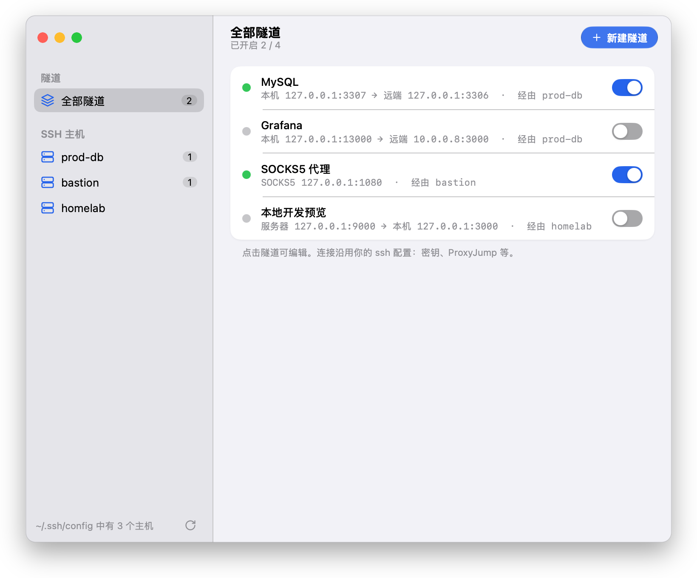
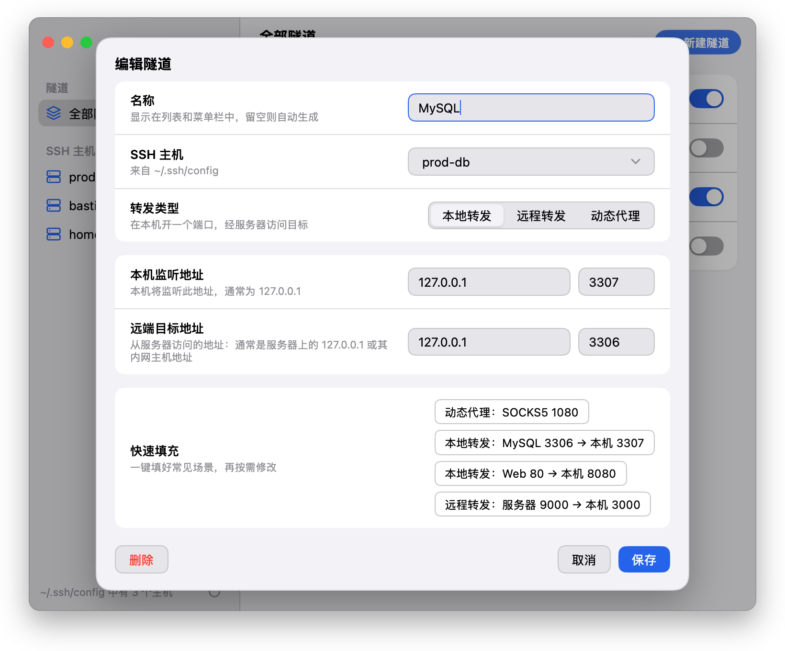
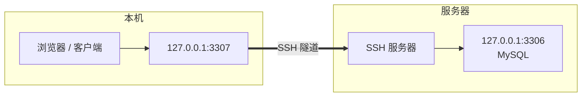

<div align="center">


# Easy SSH Port

**一键开关的 SSH 端口转发，住在你的菜单栏里。**

从 `~/.ssh/config` 导入主机，用表单配置本地转发、远程转发和 SOCKS5 代理，打开开关隧道就通了。

[](https://github.com/ji233-Sun/easy-ssh-port/actions/workflows/ci.yml)
[](https://github.com/ji233-Sun/easy-ssh-port/releases/latest)


[](https://mygo.egoist.dev/)

</div>

<br>

<picture>
  <source media="(prefers-color-scheme: dark)" srcset="docs/screenshots/list-dark.png">
  
</picture>

## ✨ 特性

- **零配置导入**：直接读取 `~/.ssh/config`，支持 `Include` 和通配，密钥、`ProxyJump`、端口这些配置都沿用你已有的。
- **三种转发**：本地转发（`-L`）、远程转发（`-R`）、动态 SOCKS5 代理（`-D`），一个表单全部搞定。
- **快速填充**：MySQL、Web、SOCKS5 等常见场景一键填好，再按需修改。
- **一键开关**：每条隧道一个开关；关掉窗口后隧道照常运行，菜单栏随时开关。
- **状态真实可靠**：只有端口真正转发成功才会亮绿灯；目标端口没有服务时，那一行会显示「访问目标失败」，不会一直亮着绿灯却连不上。
- **原生体验**：侧边栏毛玻璃、Liquid Glass 按钮、跟随系统的深浅色和强调色。

<picture>
  <source media="(prefers-color-scheme: dark)" srcset="docs/screenshots/edit-dark.png">
  
</picture>

## 📦 安装

从 [Releases](https://github.com/ji233-Sun/easy-ssh-port/releases/latest) 下载 `easy-ssh-port-<版本>.dmg`（Universal，同时支持 Apple Silicon 和 Intel），把 app 拖进「应用程序」即可。

> [!NOTE]
> 目前的安装包只做了 ad-hoc 签名，没有经过 Apple 公证，首次打开可能被 Gatekeeper 拦下。可以在「系统设置 → 隐私与安全性」里点「仍要打开」，或者执行：
>
> ```sh
> xattr -dr com.apple.quarantine "/Applications/Easy SSH Port.app"
> ```

## 🚀 使用

1. 在侧边栏选择一台主机（来自 `~/.ssh/config`），点击右上角的 **新建隧道**。
2. 选择转发类型，填写监听地址和目标地址，也可以直接点一个 **快速填充**。
3. 保存后打开开关。绿点表示隧道已经可用。

### 三种转发怎么选

| 类型 | 用途 | 示例 | 等价命令 |
|---|---|---|---|
| **本地转发** | 在本机访问服务器（或它内网）上的服务 | 本机 `127.0.0.1:3307` → 远端 `127.0.0.1:3306` | `ssh -L 127.0.0.1:3307:127.0.0.1:3306 host` |
| **远程转发** | 让服务器访问你本机上的服务 | 服务器 `127.0.0.1:9000` → 本机 `127.0.0.1:3000` | `ssh -R 127.0.0.1:9000:127.0.0.1:3000 host` |
| **动态代理** | 把服务器当作 SOCKS5 代理 | 本机 `127.0.0.1:1080` | `ssh -D 127.0.0.1:1080 host` |



> [!TIP]
> 「远端目标地址」是**从服务器的角度**来看的：`127.0.0.1` 指服务器自己，也可以填服务器所在内网的其他主机，比如 `10.0.0.8`。

## ❓ 常见问题

<details>
<summary><b>隧道亮绿灯，但浏览器显示 <code>ERR_CONNECTION_RESET</code></b></summary>

<br>

隧道本身是通的，但服务器连不上你填的目标地址，通常是这个端口上没有程序在监听。这时那一行会显示「访问目标失败：connect failed: Connection refused」。可以在服务器上检查：

```sh
ss -ltnp | grep <端口>
```

如果服务跑在 Docker 里，要用 `-p 127.0.0.1:<端口>:<容器端口>` 把端口映射到宿主机上。

</details>

<details>
<summary><b>需要输入密码的主机连不上</b></summary>

<br>

隧道在后台以 `BatchMode=yes` 运行，没法弹出密码输入框。请使用密钥登录（`ssh-copy-id host`），带密码的私钥要先加入 ssh-agent 或钥匙串：

```sh
ssh-add --apple-use-keychain ~/.ssh/id_ed25519
```

</details>

<details>
<summary><b>为什么有的主机不在列表里？</b></summary>

<br>

带通配符的 `Host *`、`Host *.example.com` 这类条目是模板而不是具体的主机，所以不会列出。改完 config 后点侧边栏底部的刷新按钮就能重新读取。

</details>

<details>
<summary><b>配置保存在哪里？</b></summary>

<br>

`~/Library/Application Support/Easy SSH Port/tunnels.json`

</details>

## ⚙️ 工作原理

每条隧道就是一个由 app 管理的系统 `ssh` 进程：

```sh
ssh -N -o BatchMode=yes -o ExitOnForwardFailure=yes \
    -o ServerAliveInterval=30 -o ServerAliveCountMax=3 \
    -o PermitLocalCommand=yes -o LocalCommand="echo easy-ssh-port:ready" \
    -L 127.0.0.1:3307:127.0.0.1:3306 -- host
```

- `ExitOnForwardFailure` 加上 `LocalCommand` 输出的就绪标记，保证端口真正转发成功后才显示「已连接」。
- ssh 退出时，会把它最后的错误信息显示在对应的那一行。
- 退出 app 时会关闭所有隧道。

## 🛠️ 从源码构建

需要 [Go](https://go.dev/dl/) 1.27+ 和 macOS。

```sh
git clone https://github.com/ji233-Sun/easy-ssh-port.git
cd easy-ssh-port

go tool mygo dev      # 开发模式，改代码自动重启
go test ./...         # 运行测试
go tool mygo build    # 打包 .app 和 .dmg 到 build/
```

### 发布新版本

修改 `mygo.json` 里的 `version`，提交后推送同名 tag，CI 会构建 Universal dmg 并创建 Release：

```sh
git tag v0.2.0 && git push origin v0.2.0
```

### 项目结构

```
main.go         窗口、菜单栏图标和应用生命周期
app.go          应用状态：隧道、开关状态、持久化
view.go         界面（MyGo native UI）
tunnel.go       隧道模型、ssh 参数、校验与存储
runner.go       ssh 进程的启动、就绪检测与错误收集
sshconfig.go    ~/.ssh/config 解析（含 Include）
resources/      app 图标与菜单栏图标
design/         图标的 SVG 源文件
```

## 🙏 致谢

基于 [MyGo](https://mygo.egoist.dev/) 构建：用 Go 写原生桌面应用。
